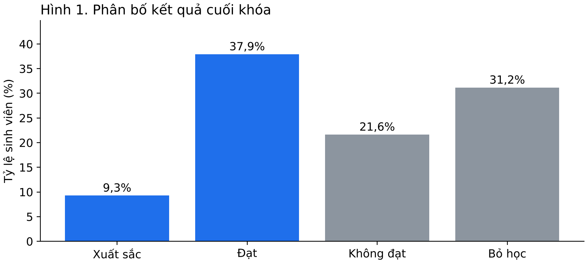
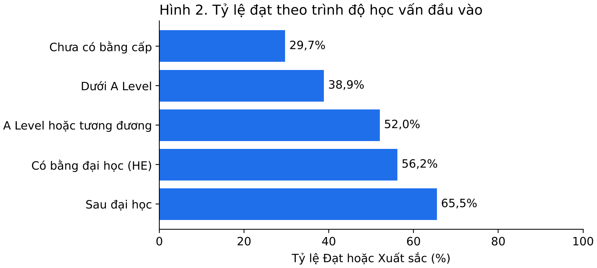

# Hành vi học tập trực tuyến và nhận thức về ChatGPT của sinh viên đại học
Đề tài nhóm – Học phần CT999 Công nghệ số nâng cao
Nhóm [số] · Trường Đại học Cần Thơ

## Bối cảnh và lý do chọn đề tài
- Học trực tuyến tạo ra dấu vết hành vi chi tiết: lượt truy cập, bài nộp, điểm
- Gần một nửa sinh viên OULAD không hoàn thành khóa học với kết quả đạt
- ChatGPT thay đổi cách sinh viên học và làm bài từ năm 2023
- Cần hiểu cả hành vi thật lẫn thái độ của sinh viên để hỗ trợ đúng lúc

## Câu hỏi nghiên cứu
- RQ1: Đặc điểm đầu vào nào liên quan đến kết quả cuối khóa?
- RQ2: Hành vi trên hệ thống học trực tuyến có dự báo sớm được kết quả không?
- RQ3: Sinh viên nhận thức thế nào về lợi ích và rủi ro của ChatGPT?

## Dữ liệu
- OULAD (Kuzilek và cộng sự, 2017): 32.593 sinh viên, 22 lượt mở môn, 10,6 triệu bản ghi lượt click; CC BY 4.0
- Khảo sát toàn cầu về ChatGPT (Ravšelj và cộng sự): 23.218 phản hồi từ 109 quốc gia; CC BY 4.0
- Cả hai bộ đã ẩn danh sẵn, tải công khai, ghi rõ nguồn khi sử dụng

## Phương pháp
- Làm sạch và tổng hợp dữ liệu bằng pandas
- Thống kê mô tả và trực quan hóa bằng matplotlib
- Mô hình Decision Tree phân loại Đạt / Chưa đạt
- Dashboard Streamlit để chọn biến, xem biểu đồ, tải báo cáo PDF

## Kết quả: phân bố kết quả cuối khóa

## Kết quả: trình độ đầu vào và tỷ lệ đạt

## Nhận xét bước đầu
- Tỷ lệ đạt chung 47,2%; bỏ học là nhóm chưa đạt lớn nhất (31,2%)
- Trình độ đầu vào càng cao, tỷ lệ đạt càng cao: từ 29,7% lên 65,5%
- Đây là tương quan, chưa phải quan hệ nhân quả

## Hướng tiếp theo
- Bổ sung lượt click theo tuần để dự báo sớm sinh viên có nguy cơ
- Phân tích khảo sát ChatGPT để trả lời RQ3
- Hoàn thiện dashboard và báo cáo PDF tự động
